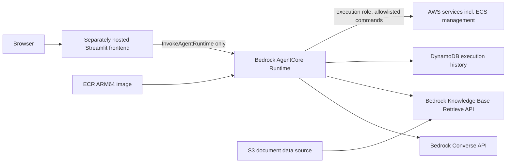

# AgentCore deployment design

This repository contains deployment code only. It does not create AWS resources,
call Terraform, invoke `agentcore deploy`, or run CodeBuild.



## Runtime contract

`agentcore/runtime_entrypoint.py` implements AgentCore's custom-container
contract: `GET /ping` and `POST /invocations` on port 8080. It uses the
AgentCore execution role's short-lived credentials. It ignores caller-supplied
profiles and credentials. The runtime is deliberately non-root and built for
`linux/arm64`.

The invocation API has three actions: `plan`, `approve`, and `execute`.
Planning is always dry-run; a stored immutable plan must be approved before it
can be executed. The Streamlit client sends only those requests and must receive
narrowly scoped `bedrock-agentcore:InvokeAgentRuntime` and
`bedrock-agentcore:InvokeAgentRuntimeForUser` permissions. It must not receive
the runtime's infrastructure permissions.

## Required AWS configuration (manual)

1. Create an ECR repository, build this `Dockerfile` for ARM64, and push it.
   `buildspec.yml` is a CodeBuild template; it does not start builds itself.
2. Create an AgentCore Runtime from the image and configure its execution role.
   The role needs only the approved actions required by your service policy,
   `bedrock:Converse`, `bedrock:Retrieve`, DynamoDB item access to the history
   table, ECR image pull, and CloudWatch Logs/observability permissions.
3. Create an S3-backed Bedrock Knowledge Base, run ingestion, and set
   `BEDROCK_KNOWLEDGE_BASE_ID`. Configure metadata field `department` only if
   you need department filtering.
4. Create the DynamoDB history/state table in advance. Its partition key is
   `PK` (String). The application stores `EXECUTION#<id>` history records and
   `PLAN#<id>` approval records in it, and does not create or alter the table.
   For large histories, add a timestamp index and set
   `DYNAMODB_HISTORY_TIMESTAMP_INDEX`.
5. Host `frontend/streamlit_app.py` separately. It is intentionally outside the
   AgentCore image/runtime role boundary.

## Configuration templates

`deploy/agentcore-runtime-config.example.json` records the required HTTP
protocol and `X-Principal-Id` header allowlist. The two policy examples in
`deploy/iam/` separate the frontend's invoke-only permission from the Runtime
execution role. Replace every placeholder and replace the deliberately invalid
`REPLACE_WITH_REVIEWED_ACTIONS_ONLY` action with only the service actions your
approved workload requires; do not attach that template unchanged.

## Security and migration notes

- ECS is still supported as a *managed target service* through `services/ecs.py`;
  it is not an agent-hosting option.
- The existing compiler, dependency graph, policy engine, safety gate and
  approval manager are retained.
- Planning is always dry-run. Live execution remains disabled until
  `AGENTCORE_EXECUTION_ENABLED=true` is deliberately set on the Runtime after
  its execution-role policy is reviewed. Approval records are owner-scoped and
  conditionally updated in DynamoDB to prevent duplicate execution.
- Configure AgentCore inbound authentication and add `X-Principal-Id` to its
  request-header allowlist. The frontend must set `FRONTEND_PRINCIPAL_ID` from
  a verified identity-provider claim; it is not a browser form field.
- The legacy monolithic `app.py` remains for local development only and should
  not be deployed with production credentials.
- Knowledge Base ingestion is performed by AWS after S3 upload; local document
  upload/index operations are intentionally not exposed by the new frontend.

## Pre-deployment verification

```text
pytest -q
python -m compileall agent agentcore aws config history rag security services frontend
docker build --platform linux/arm64 -t aws-agent:local .
```

Verify service/model availability, quotas, AgentCore regional support, and model
access in the target account before creating resources. Model IDs and Knowledge
Base availability vary by region.
